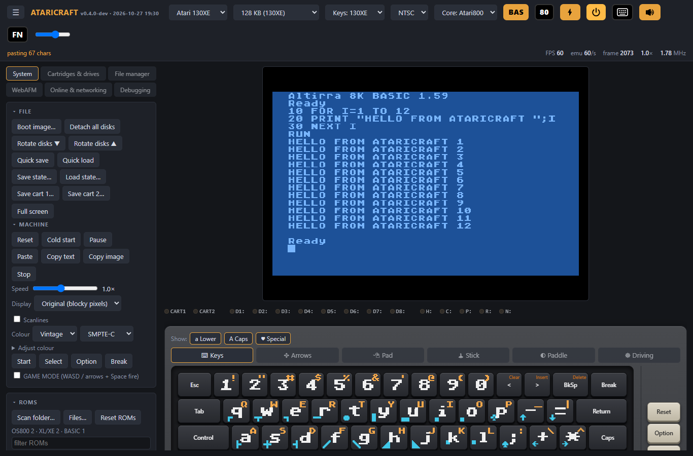
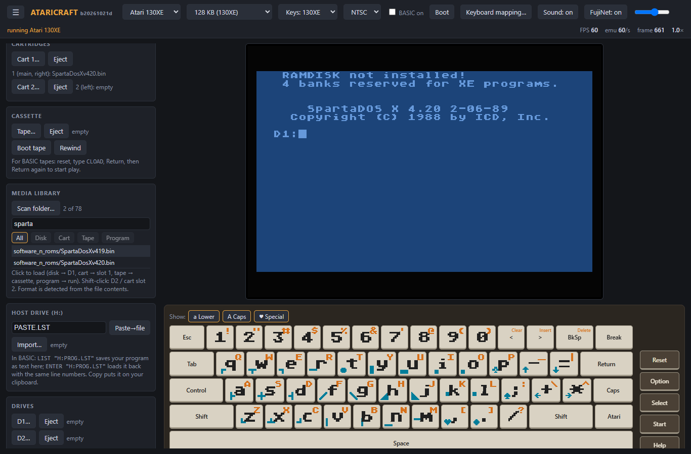
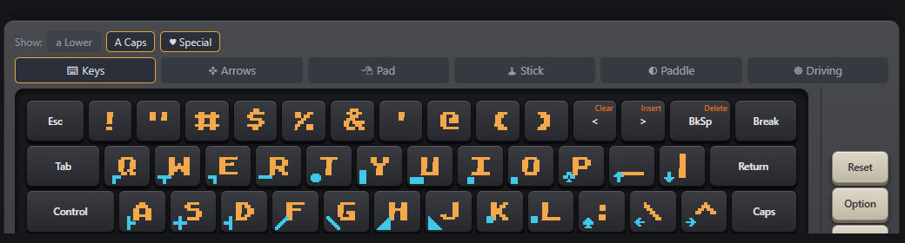
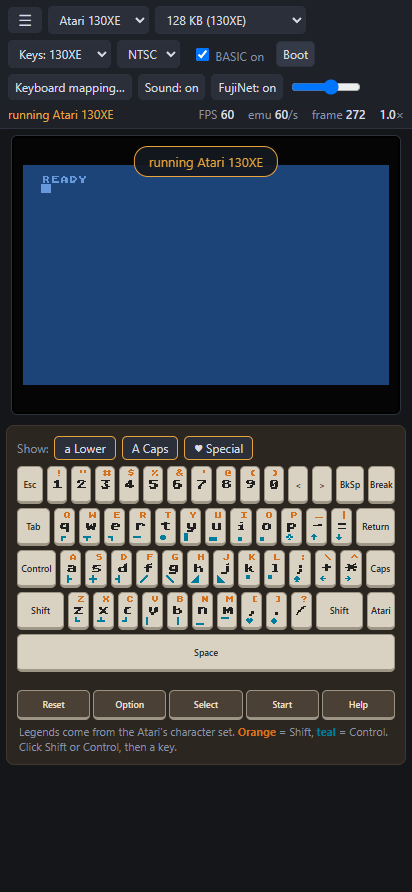

# ataricraft

A web-based Atari 8-bit emulator in the Craft family: humans and agents drive the same engine.

Status: **working browser emulator** on the libatari800 reference core (see `NOTES.md` for done / to-do). Open `web/index.html` directly from disk; no server needed.



## Quick start

1. Download the release zip and unzip it. Open `web/index.html` in Chrome or Edge (it runs from disk, no server, no install, works offline).
2. **ROMs are not included.** Click **Scan folder…** (ROMs panel) and pick a folder holding your Atari OS ROM (e.g. XL/XE OS) and optionally the Atari BASIC ROM. Choose them in the **OS** and **BASIC** boxes. The choice is remembered in the browser; **Reset ROMs** forgets it.
3. Pick a model and memory size in the header, then press **Boot**. You should see `READY`.
4. Type on your keyboard or use the on-screen keyboard (click Shift/Control, then a key).

## Loading software

Everything is detected from the file contents, not the extension.

| You have | Do this |
|---|---|
| Disk (ATR, XFD, ATX, DCM, PRO, `.gz`) | **D1…** button, or click it in the Media library. Shift-click mounts on D2. |
| Cartridge (CART or raw ROM) | **Cart 1…** (right slot) or **Cart 2…** (left). Raw ROMs ask for the cartridge type. |
| Program (XEX, COM, BAS, LST) | Click it in the Media library, or Paste for BASIC text. |
| Cassette (CAS) | **Tape…** then **Boot tape** (Start held). For BASIC tapes: reset, type `CLOAD`, Return, Return. |

**Media library**: **Scan folder…** lists every disk, cart, tape and program in a folder. Filter by text and by type chips, then click a file to load it.



### SpartaDOS X

Click `SpartaDosX*.bin` in the Media library (or load it in Cart 1). It is recognised automatically: the cartridge type is set, **BASIC on** is switched off, and the machine reboots to the `D1:` prompt. Try `DIR`, `HELP`, `X`, `BASIC`, `CAR`.

### BASIC on/off

The **BASIC on** checkbox applies immediately (reboots) and is remembered. Cartridges stay inserted across reboots.

## Keyboard



The on-screen keyboard shows the Atari glyphs on the keys. **Show: Lower / Caps / Special** picks which legends appear. Orange = Shift, teal = Control. It scales to the window. Physical and on-screen keys can be mixed. **Keyboard mapping…** rebinds keys; the **Keys:** box picks the 130XE / 65XE / 800XL / 1200XL / 800 layout.

## Other features

- Messages pop up as a bubble over the screen; the last one stays on the second header line next to FPS.
- **H: host drive**: in BASIC, `LIST "H:PROG.LST"` saves your program as text in the browser, `ENTER "H:PROG.LST"` loads it back. Import / Copy move it in and out.
- **FujiNet** (header toggle): virtual SIO device `$70`. **Boot FujiNet CONFIG**, pick a folder as a host, mount disks into slots. Hosts and slots persist; **Reset config** clears them.
- Sound, volume, speed slider, Paste / Copy text / Copy image, joystick on arrows + Space.
- The side panel collapses with ☰. Phone and tablet layouts work (tested at Pixel 6 Pro XL and Galaxy Tab S sizes).



## Known limits

WAV tapes, 5200 / 7800 carts and saved states are not supported. DCM and PRO are verified (DCM sector 1 decodes, PRO boots identically to its ATR). ATX (copy-protected) is compiled in but untested for lack of a sample file. Tape playback and some FujiNet paths are lightly tested. The media library is not remembered between visits. See `NOTES.md`.

## Licence

atari800 / libatari800 is GPL-2.0, and ataricraft ships a WASM build of it, so this project is distributed under **GPL-2.0** (see `LICENSE`). Source for the build is in this repository (`build/`, `scripts/`) plus upstream atari800 with `build/atari800-sio-hook.patch`.

## Using it (short)

- Pick a model and memory size, scan your ROM folder (OS and BASIC), choose the ROMs, then **Boot**. Scanned ROMs and your selection are kept in the browser (IndexedDB / localStorage); **Reset ROMs** clears them.
- **Media**: disks (ATR, XFD, ATX, DCM, PRO, gzipped), cartridges (CART, raw ROM with type picker; two slots), cassette (CAS), and programs (XEX, COM, BAS, LST). Formats are detected from contents. The Media library panel scans a folder and filters by text and type; ROMs have their own filter.
- On-screen keyboard shows Atari glyphs; **Show: Lower / Caps / Special** toggles which legends appear. It scales to the available width.
- Physical and on-screen keys can be mixed (Shift/Control latch). Sound and key-click are optional.
- **FujiNet** (header toggle): a virtual device `$70` on SIO. **Boot FujiNet CONFIG** loads the CONFIG boot disk, lists hosts, browses the folder you picked, and mounts disks into slots. Hosts and slots persist; **Reset config** clears them.
- The side panel collapses (☰); phone and tablet layouts are supported (tested at Pixel 6 Pro XL and Galaxy Tab S sizes).

## Building the WASM core

`web/ref/` and `vendor/` are git-ignored. Clone upstream, apply the SIO hook, then build:

```
git clone --depth 1 https://github.com/atari800/atari800 vendor/atari800
git -C vendor/atari800 apply ..\..\build\atari800-sio-hook.patch
powershell -File scripts\build-reference.ps1
```

## Goals (from Jeff, 2026-10-21)

- All 8-bit models: 400, 800, 600XL, 800XL, 65XE, 130XE (later XEGS).
- Two (eventually more) floppy drives, cassette emulation.
- On-screen keyboard showing the Atari glyphs and special characters on the keys, with Ctrl / Shift / Inverse layers, so they are easy to type.
- FujiNet support.
- Headless, agent-drivable (craftapi style: describe / state / apply / snapshot / restore / score / render).
- Long term: a cycle-exact core usable as a spec for an FPGA implementation.
- Adjustable clocks. (a) Emulation speed vs wall time, from 1:1 to as fast as the host allows: the core steps by cycles/frames and never reads the host clock. (b) CPU clock ratio vs the Atari bus (accelerated CPUs while ANTIC/POKEY keep stock timing): CPU and bus are separate clock domains with a configurable ratio.
- Enhanced hardware, as swappable chip modules (names to be confirmed with Jeff): Ultimate1MB (U1MB), PokeyMAX (POKEY replacement, SID mode), VBXE / Sophia-style video replacements. Core design: CPU, ANTIC, GTIA, POKEY, PIA and the memory map sit behind interfaces, with a stock implementation and enhanced replacements for each.
- ROMs are user-supplied and never committed. Public builds should use freely distributable replacement OS ROMs.

## Plan

1. **Reference core**: libatari800 (from atari800, GPL-2.0) built to WASM. Gives a working oracle and snapshot support (`libatari800_get_current_state` / `restore_state`).
2. **Own core in Rust** (`core-rs/`, wasm32 + wasm-bindgen), written as a cycle-exact state machine from the Altirra Hardware Reference Manual. One chip at a time: 6502, ANTIC, GTIA, POKEY, PIA, then memory models.
3. **Differential testing**: same media and inputs through both cores, compare CPU/memory/frame state per frame. That is the score signal.
4. **Web shell** (`web/`): screen, keyboard, drives, tape, craftapi layer.
5. **FujiNet**: JS-emulated device on SIO first (disk mounts from URL, N: over fetch/WebSocket); then a bridge to FujiNet-PC (NetSIO); WebSerial to real hardware later.

## Layout

| Path | Purpose |
|---|---|
| `scripts/build-reference.ps1` | Build libatari800 to `web/ref/` with Emscripten |
| `build/config.h` | Hand-written config for the Emscripten build (no autotools) |
| `core-rs/` | Rust core (not started) |
| `web/` | Browser shell (the emulator UI) |
| `roms/` | Your ROMs. Git-ignored. |
| `vendor/` | Upstream sources (git-ignored): `git clone --depth 1 https://github.com/atari800/atari800 vendor/atari800` |

## Build the reference

Needs Emscripten (`C:\Users\raver\tools\emsdk`, or set `EMSDK_DIR`).

```
powershell -File scripts\build-reference.ps1
```

## References and licences (verify before reusing code)

- atari800 (GPL-2.0), including `libatari800` and `netsio.c` (FujiNet NetSIO).
- A8E / jsA8E (GPL-2.0), 800XL only; has a browser automation surface worth studying.
- Altirra Hardware Reference Manual (timing spec) and Altirra OS (replacement ROMs).
- MAME Atari 8-bit drivers; RetroArch atari800 libretro core.
- Existing FPGA cores (e.g. MiSTer Atari 800): check licences.

Anything derived from GPL code must be GPL. A clean-room Rust core written from the hardware manual can use any licence.
