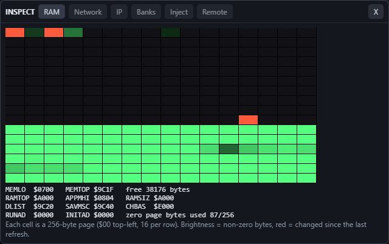
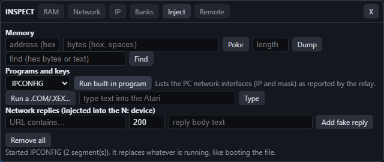
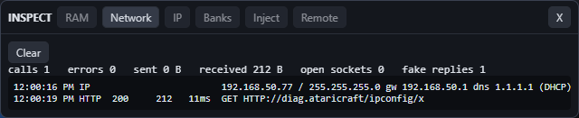
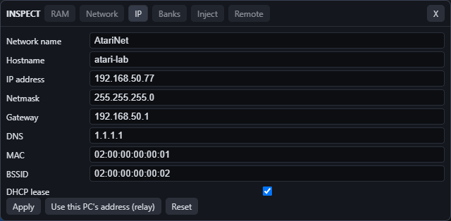
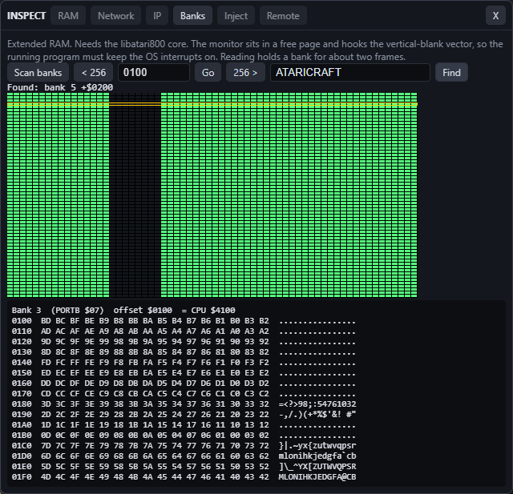

# Inspector and remote control

**Inspect** (Tools hub, `tools.html#insp`, linked to the emulator tab; see [TOOLSHUB.md](TOOLSHUB.md)) opens a floating panel (drag the title bar; **X** closes it) with six views. Hover any button for a one-line tip.



- **RAM:** a 256-page map ($00 top-left, 16 per row; brightness = non-zero bytes, red = changed since the last refresh, hover for the page), plus MEMLO/MEMTOP/free bytes, RAMTOP, APPMHI, DLIST, SAVMSC, CHBAS, RUNAD/INITAD and zero-page use. Programs started through `ataricraft.bootFile` or the Inject tab have their XEX segments recorded ("Last load").
- **Network:** every call the virtual FujiNet N: device makes through the relay (HTTP, TCP, UDP, TNFS, SD): time, status, bytes, duration, open sockets, byte totals.
- **IP:** the adapter settings the Atari sees (IP, netmask, gateway, DNS, MAC, SSID, hostname, DHCP flag). Apply them, or copy this PC's address from the relay. The FujiNet adapter-config command ($E8/$C4) returns these values. Defaults are unchanged (127.0.0.1).
- **Banks:** extended RAM, see below.
- **Inject:** run things in the emulator, see below.
- **Remote:** connects this page to the relay for outside control. A page opened from the relay address connects by itself.

### What each button does

| Tab | Control | Effect |
|---|---|---|
| Network | Clear | Empties the log and zeroes the counters |
| IP | Apply | The virtual adapter now reports these values (read with FujiNet command $E8 or IPCONFIG-style tools) |
| IP | Use this PC's address (relay) | Copies the PC's first non-loopback IPv4 address, mask and gateway from the relay, then applies |
| IP | Reset | Back to 127.0.0.1 / 255.0.0.0, DHCP off |
| Banks | Scan banks | Installs the bank monitor, maps every bank in turn and draws the heat map (one row per 16 KB bank, one cell per 256-byte page; brightness = non-zero bytes) |
| Banks | click a row | Selects that bank for the hex view |
| Banks | < 256 / 256 > / offset + Go | Moves the 256-byte hex view inside the bank (offset 0000-3EFF; bank offset 0 is CPU $4000) |
| Banks | find + Find | Searches every bank for hex bytes (`DE AD BE EF`) or text; lists `bank N +offset` |
| Inject | address + bytes + Poke | Writes the bytes into memory at the hex address while the program runs |
| Inject | address + length + Dump | Shows memory as hex |
| Inject | find + Find | Searches the 64 KB CPU view |
| Inject | program list + Run built-in program | Boots one of the bundled programs directly (no disk needed); it replaces whatever is running |
| Inject | Run a .COM/.XEX... | Boots a program file from your PC |
| Inject | type text + Type | Sends the text to the Atari as keystrokes |
| Inject | URL part, status, body + Add fake reply | N:HTTP requests whose URL contains the text get that reply (marked `[mock]` in the log) |
| Inject | Remove all | Deletes the fake replies |
| Remote | Connect / Disconnect | Starts or stops taking commands from the relay (`tools/ctl.cjs`) |

### Built-in programs

Run from Inject, or `AC.Inspect.runProg('PING')`, or `node tools/ctl.cjs prog PING` (list: `node tools/ctl.cjs progs`). They are bundled into `web/js/progs.js` by `node tools/progs/build.cjs`.

| Group | Programs |
|---|---|
| Network | PING, NSLOOKUP, TRACERT, WHOIS, IPCONFIG (these use the FujiNet N: device and the relay, so enable FN and start the relay) |
| Self test | CPUTEST, MEMTEST (base RAM), GFXTEST, SNDTEST, KEYTEST, BANKTEST (fills every extended bank with a pattern) |
| Demo / utility | TUIDEMO, CALC, 80COL, AFM, AFM80 |





## Extended RAM banks



The Banks tab (or `AC.Inspect.banks`: `scan()`, `read(bank, off, len)`, `write`, `fill`, `find`) shows every 16 KB bank behind the $4000 window. RAM sizes are 128, 192 (Compy-Shop), 320 (Rambo/Compy-Shop), 576 and 1088 K (4, 8, 16, 32, 64 banks); Axlon sizes are covered in Memory configurations below.

- Neither WASM core exposes extended RAM, so a ~380-byte monitor (`tools/bankmon`, rebuilt with `node tools/bankmon/build.cjs`) is injected into a free page and hooks the VBI vector. Reading holds a bank mapped for about two frames.
- Needs libatari800. On Altirra the page only gets a read-only copy of the 64 KB view, so it reports an error.
- Programs that replace the NMI/VBI vector or disable OS interrupts will stop the monitor responding (it times out with an error).
- There is no 256K or 512K option in the emulator; the XL/XE sizes are 128, 192, 320 (Rambo and Compy-Shop), 576 and 1088.
- Tested: `node scripts/bank-test.cjs` (libatari800 at 128, 320 Rambo, 576 and 1088K: every byte of every bank, write/readback, find) and `node scripts/inspect-ui-test.cjs` (the buttons). Not tested: 320 Compy-Shop banking, real hardware (a real machine would need the monitor loaded from disk and a way to read the bank out).
- From outside: `node tools/ctl.cjs banks | bank N [OFF] [LEN] | bankfind "text" | bankwrite N OFF BYTE...`.

## From outside the browser

Start the relay (`node tools/tnfs-bridge/bridge.cjs`), open its address in a browser, then run `tools/ctl.cjs` with the relay's token:

```
set AC_TOKEN=<token printed by the relay>
node tools/ctl.cjs state | ram | net | ip | screen
node tools/ctl.cjs setip ip=192.168.1.50 mask=255.255.255.0 gw=192.168.1.1
node tools/ctl.cjs peek 0600 32
node tools/ctl.cjs poke 0600 A9 01 60
node tools/ctl.cjs run GAME.XEX
node tools/ctl.cjs progs
node tools/ctl.cjs prog IPCONFIG
node tools/ctl.cjs banks
node tools/ctl.cjs mock diag.ataricraft/ping 200 "FAKE REPLY"
node tools/ctl.cjs shot out.png
```

Under the hood it POSTs `{method,args}` to the relay's `/ctl/call`; the page long-polls `/ctl/poll`, runs the call from a fixed allow-list (see `AC.Remote` in `web/js/inspect.js`) and answers through `/ctl/result`. Every call needs the relay token. The relay only listens on 127.0.0.1.

Test: `node scripts/inspect-test.cjs`. Not checked: a second machine on the LAN driving it, or real FujiNet software reading the changed IP.

## Memory configurations (RAM dropdown)

Entries a core cannot emulate stay in the list but are disabled, with the reason as a tooltip; the choice is remembered per core switch and in localStorage (c.ctl). Logic: web/js/ramsel.js; lists: XL_RAM/AXLON/ACX in web/js/emu.js, RAM in web/js/emu-altirra.js. Test: 
ode scripts/ram-config-test.cjs.

| Entry | libatari800 | AltirraSDL | Verified |
|---|---|---|---|
| Compy-Shop 192 KB (XL/XE) | yes, via a generated config file (RAM_SIZE=192; there is no CLI option) | no | PORTB memtest: 8 banks, 0 errors |
| Axlon 2096 KB (2 MB) (400/800) | yes, -axlon 2080: 128 banks of 16 KB | no | $CFFF bank register: 128 distinct banks |
| Axlon 4144 KB (4 MB) (400/800) | yes, -axlon 4128: 256 banks | no | $CFFF bank register: 256 distinct banks |
| ACX 8192 KB (Ataricraft 8 MB) | no, disabled | no, disabled | not implementable |

- Axlon: atari800 takes a total of 32 + 16 x banks KB with a power-of-two bank count up to 256, so the labels (2096, 4144) map to 2080 and 4128. The bank number is written to $CFFF; the window is $4000-.
- Altirra: the WASM build only exposes ltirra_memory (8K to 64K, 128K, 256K, 320K, 576K, 1088K, Compy variants) plus Rapidus/65C816. There is no 192K or Axlon. Rapidus 65C816 high memory was tried; long-address stores hang in this build, so 8 MB could not be confirmed.
- ACX 8192 is the Ataricraft product's own 8 MB RAM and is a placeholder here. Intended scheme (to be fixed for the real system): 512 banks of 16 KB behind a bank register selecting the $4000- window, i.e. an Axlon-style register extended to 9 bits. Booting it shows an explanatory message instead of starting.
